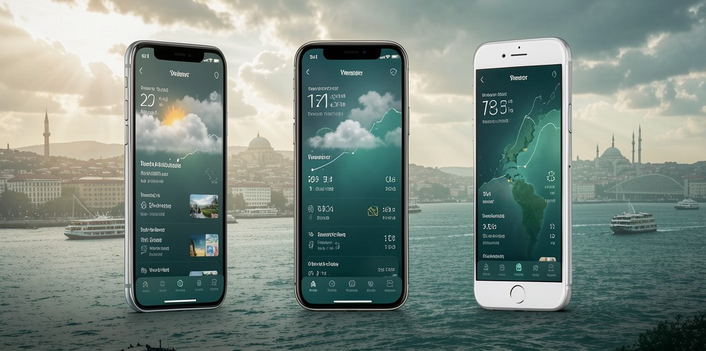
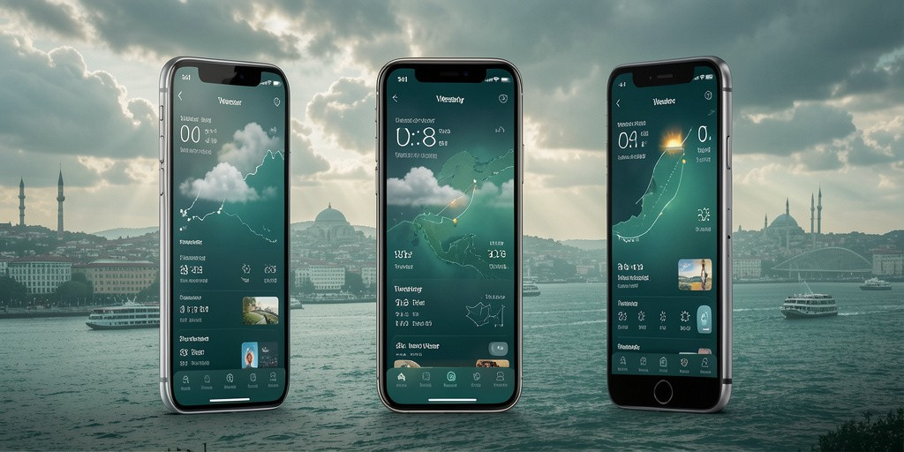

# 🌤️ Weather App — Modern 3D Experience

A modern, feature-rich weather application built with Flutter, featuring a clean interface, real-time weather information, location search, dynamic 3D visual elements, and a personalized experience.

Designed with a premium **Emerald Atmosphere** visual identity, supporting English and Turkish languages, alongside Dark and Light themes.

*This project was developed leveraging open-source packages released by the developer community.*  

---

## 📱 App Showcase

<p align="center">
  
</p>

<p align="center">
  
</p>

---

## ✨ Features

- **Current Weather**: Instant temperature updates, live atmospheric conditions, and feels-like readings.
- **Hourly Forecast**: Granular weather conditions for upcoming hours.
- **7-Day Forecast**: Weekly outlook to plan ahead.
- **Modern 3D UI & Emerald Theme**: Premium visuals with seamless Dark/Light theme switching.
- **Location Search & Favorites**: Search global cities and bookmark your most frequented places.
- **Multilingual Support**: Fully localized in English 🇬🇧 and Turkish 🇹🇷.
- **Offline Caching & Persistence**: Local caching for offline access and saved user settings.

---

## 🎨 Design & Color Palette

The application adheres to an **Emerald Atmosphere** design system:

| Role | Color Name | Hex Code |
|---|---|---|
| **Deep Background** | Dark Emerald | `#101F20` |
| **Secondary Background** | Medium Emerald | `#1B3838` |
| **Primary Accent** | Emerald Green | `#347C75` |
| **Soft Accent** | Mint Green | `#8BC9B3` |
| **Light Surface** | Pale Mint | `#F0F7F2` |

---

## 🛠️ Built With

- **Framework**: [Flutter](https://flutter.dev) & [Dart](https://dart.dev)
- **State Management**: [Riverpod](https://riverpod.dev)
- **API**: [WeatherAPI](https://www.weatherapi.com/) via REST services
- **Storage**: Local Data Persistence & Caching

---

## 📂 Project Structure

```text
weather_app/
├── android/
├── assets/
│   └── redme/
├── lib/
│   ├── data/          # Data sources, repositories, and models
│   ├── domain/        # Business logic and entity models
│   ├── presentation/  # UI screens, widgets, and Riverpod providers
│   └── main.dart      # Application entry point
├── test/
├── .env.example
├── .gitignore
├── l10n.yaml
├── pubspec.yaml
└── README.md
